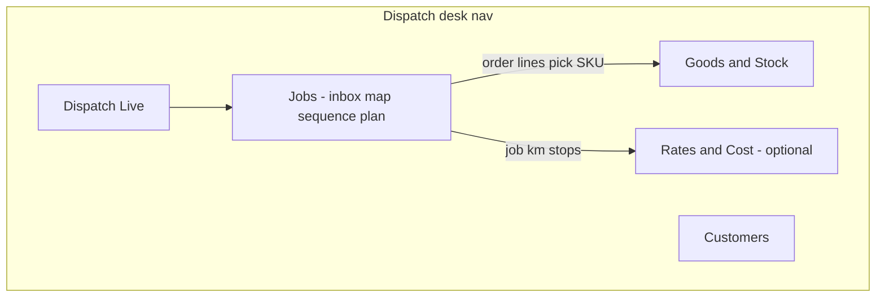

# Plan & Discussion: Goods stock, price, operating cost, Jobs layout

**Status:** decisions locked (2026-10-14) — **no implementation until you explicitly order it.**

---

## 1) Goods → Stock inventory per depot

### Today

- Goods List = tenant catalog (SKU, unit, m³/kg, optional display `on_hand_qty`).
- Product promise (M1 scan phases / promo): on-hand is **display-only**; pickup / delivery / scan do **not** change stock.
- `reserved_qty` exists but is unused.
- One on-hand number per SKU for the whole tenant — **not per depot**.

### Proposed model (recommended)

Keep **one catalog SKU**, add **balances per depot**:

| Layer | Role |
| --- | --- |
| Catalog SKU | Master item (name, unit, m³/kg, later price) |
| Stock bin | `SKU × depot` on-hand |
| Optional truck / in-transit | Qty on a job after pickup |

**Flow (full accuracy):**

1. Assign / plan → optional reserve at source depot  
2. Pickup at depot (or depot stop done) → depot ↓, truck ↑  
3. Deliver stop → truck ↓  
4. Skip / return / cancel → reverse or return to depot  

**Simpler first slice:** decrement depot on **pickup complete** only (no truck layer), then add delivery / truck later.

### First build slice (when approved)

1. `stock_balance(sku, depot_id)`  
2. Manual adjust / receive at depot  
3. Auto decrement on pickup (or chosen event)  
4. Desk: Goods master + per-depot stock view  
5. Reservations / truck stock / cycle count = phase 2  

### Confirms later (stock)

1. Stock move event: pickup / delivery / both (depot→truck→customer)?  
2. Source depot: job depot, zone→depot map, or explicit on order?  
3. Insufficient stock: hard block or warn?  
4. Require cargo scan to move stock, or Finish is enough?  
5. How to handle returns / partials / failed stops?  

---

## 2) Goods price

### Today

- Dispatch goods have **no** selling / cost price (maintenance catalog parts already have unit price / cost).
- Order lines have qty / unit / m³ / kg only — no line amount.

### Why add it

- Quote / invoice-ready cargo value on orders  
- Margin vs delivery operating cost (section 3)  
- Optional customer price lists later  

### Recommended price model

On **catalog SKU** (master):

- `sell_price` (IDR per unit) — what customer pays  
- Optional `cost_price` (IDR per unit) — COGS for margin  
- Currency default IDR  

On **order line** (snapshot when added):

- `unit_price` copied from catalog (editable override)  
- `line_amount = qty × unit_price`  
- Order header: `goods_subtotal` (sum of lines)  

**Do not** tie price changes to stock moves. Price is commercial; stock is logistics.

### Phases

1. Catalog sell (+ optional cost) + Goods List / CSV  
2. Snapshot onto order lines + order subtotal  
3. Later: per-customer price lists, tax, discounts  

### Confirms later (price)

5. Sell price only, or sell + cost?  
6. Allow unit price override on the order line?  
7. Show money on Field / POD / customer WhatsApp?  
8. Tax / PPN in first slice? (**recommend no** for v1)  

---

## 3) Delivery operating cost — recommendation

Goal: know **what it costs to run the trip** vs **goods revenue**, without becoming a full accounting system.

### Recommended cost layers

**A. Trip / job operating cost (primary)** — per job / service day:

| Component | Source | Notes |
| --- | --- | --- |
| Distance cost | Planned or actual km × Rp/km | OSRM / planned km first; actual later |
| Time / driver cost | Duration × Rp/hour or fixed per trip | Fixed-per-trip is fine for v1 |
| Per-stop cost | Stop count × Rp/stop | Optional |
| Toll / extras | Manual or routing flag | Optional |
| Fixed trip fee | Flat Rp per job | Optional |

**v1 formula (recommended):**

`operating_cost ≈ (distance_km × rate_km) + (stops × rate_stop) + fixed_trip`

Optional later: `+ duration_h × rate_hour`.

**B. Goods COGS (optional, from §2)**  

`cogs = sum(qty × cost_price)` for **delivered** lines only.

**C. Contribution (desk KPI, not GL)**  

`goods_subtotal − cogs − operating_cost`

### Where rates live

Tenant (or later depot) **cost rates** settings:

- Rp/km, Rp/stop, Rp/hour, fixed/trip  
- Optional per depot / vehicle class later  

### When to calculate

1. After Auto-plan / Optimize → **estimated** operating cost on the job  
2. After job done → **actual** using completed distance/time if available  
3. Show on Jobs job card; optional Dispatch Live rollup  

### Out of scope for v1

- Fuel receipts, driver payroll, accounting GL  
- Per-customer contract costing  
- Automatic toll invoices  

### Confirms later (operating cost)

9. v1 components: km + stop + fixed? add hour?  
10. Rates: tenant-global or per depot?  
11. Estimated after plan only, or also actual after done?  
12. Show margin vs goods sell on desk?  

---

## 4) Jobs page redesign / relayout

### Problem

Jobs packs many concerns into one board: inbox, map, job sequence, Auto-plan, goods catalog, customers, capacities, depots, optimize, multi-day, etc. Adding **inventory + price + cost** will make one page worse.

### Recommended information architecture

Keep **Jobs** as the execution board; move masters and money to sibling modules (same desk / Dispatch APK nav).

### Proposed split

| Surface | Owns |
| --- | --- |
| **Jobs** | Inbox, create/edit order (light), assign, map, sequence, Auto-plan, Optimize, Field assign |
| **Goods & Stock** (new page) | Catalog SKU, prices, per-depot stock, adjustments, print / NFC |
| **Customers** | Already a panel — keep or promote to page |
| **Settings / Rates** | Rp/km, Rp/stop, fixed trip (Admin or thin Dispatch settings) |
| **Dispatch Live** | Monitor only |

### Jobs slim-down (without a big visual redesign)

1. Remove embedded full Goods catalog from Jobs → link “Open Goods & Stock”  
2. Order form keeps **line picker** only (search SKU / scan), not catalog admin  
3. Auto-plan stays on Jobs (core to dispatching)  
4. Customers stay link-out or compact picker  
5. Phone Dispatch APK: add **Goods** next to Jobs / Live when inventory ships  

### Heavier redesign (later option)

- Jobs as three tabs only: **Inbox | Plan | Job** (catalog/customers never inline)  
- Desktop: optional board + drawer for order edit  
- Avoid rebuilding map/sequence until the IA split is done  

### Recommendation

**Do the IA split first** (Goods & Stock page + thinner Jobs), then land inventory / price / cost on the new page — not more panels on Jobs.

### Confirms later (layout)

13. New nav label: “Goods” vs “Stock” vs “Goods & Stock”?  
14. Customers stay panel or become a page?  
15. Cost rates under Admin entitlements or Dispatch settings?  
16. Dispatch APK: expose Goods page, or desk browser only at first?  
17. Any must-keep panels that must stay embedded on Jobs?  

---

## 5) Goods unit — changeable (qty / box / bag / …)

### Today (important clarification)

Unit is **already not “always volume.”** Catalog + order lines use a **count unit**:

- Allowed today: `pcs` | `box` | `bag` | `kg` | `L`  
- Separately, each item can store optional **`volume_m3_each`** and **`weight_kg_each`** — those are **capacity attributes of one unit**, used so Auto-plan can fill the truck (m³ / kg). They are not the unit label itself.

So “2 box” of Oil is valid today; the confusion usually comes from the UI still pushing m³/kg for planning, which feels like everything is “volume.”

### Gaps vs what you want

| Need | Today | Gap |
| --- | --- | --- |
| Pick pcs / box / bag / kg / L | Yes (fixed enum) | Cannot add custom units (e.g. carton, pair, drum, set) |
| Change unit on catalog / line | Yes within enum | No tenant-defined list |
| Pack math (1 box = 12 pcs) | No | Stock & price ambiguous across units |
| Hide m³/kg when not needed | Partial | Always capacity-oriented for CVRP |

### Recommendation

1. **Keep selling/stock unit as the primary unit** (pcs, box, …) — this is the “changeable unit.”  
2. **Expand units** in two steps:  
   - v1: richer preset list (`carton`, `pack`, `drum`, `set`, `pair`, …) + keep current five  
   - v2: tenant **custom units** table (code + label)  
3. Optional **pack size**: `units_per_parent` (e.g. 1 box = 12 pcs) so stock can normalize to a base unit.  
4. **Capacity fields stay optional** — if empty, Auto-plan uses order-level m³/kg only (or seat/passenger mode — §6).  
5. UI: label clearly — “Unit (qty)” vs “Volume each (m³)” / “Weight each (kg)” so unit never looks like “volume only.”

### Confirms later (units)

18. Enough to expand the fixed list, or need fully custom tenant units?  
19. Need pack conversion (box ↔ pcs) for stock?  
20. For some tenants, hide m³/kg entirely (passenger / sales — see below)?  

---

## 6) Jobs as passenger pick-up & drop — recommendation

### What already fits

Jobs is already close to a **ride / passenger / shuttle** workflow:

- Order kinds: **drop**, **pickup**, **pickup_drop** (collect A → deliver B)  
- Windows, zones, map pin, Optimize, Auto-plan, Field start/finish, Live Progress  
- Multi-stop tours = multi-passenger routes in one vehicle  

### What to reinterpret (same module, different “skin”)

| Delivery concept | Passenger concept |
| --- | --- |
| Order / stop | Trip request / passenger booking |
| Customer name | Passenger name |
| Goods lines | Optional: luggage / seat count (or skip goods) |
| Volume / weight capacity | **Seat capacity** (and optional wheelchair / luggage) |
| POD photo | Optional passenger photo / signature / OTP |
| Depot | Hub / pool / office start |
| Soft TW 08:00–21:00 | Pickup / drop appointment windows |

### Recommended approach (reuse, don’t fork)

**Mode / profile on the tenant or job type:** `cargo` | `passenger` | `mixed`

When `passenger`:

1. **Capacity** = seats (integer), not m³/kg (or seats + luggage kg).  
2. Order form: passenger count, pickup & drop pins (reuse `pickup_drop`), phone, notes.  
3. Hide or de-emphasize Goods catalog; optional “luggage” as a simple qty.  
4. Auto-plan: same CVRP, but vehicle capacity = seats; demand = passenger count.  
5. Field: same navigate → arrive → finish; wording “Passenger” / “Boarded” / “Alighted.”  
6. Live: same map + Progress timeline.  

**Do not** build a separate passenger product first — a **Dispatch profile** keeps one codebase.

### v1 passenger slice (when approved)

1. Tenant flag or job template: “Passenger mode”  
2. Seat capacity on vehicle presets  
3. Order: passenger count + pickup_drop required  
4. Labels / Field copy for passenger  
5. Skip goods/stock for that tenant (or leave unused)  

### Later (only if sold)

- Shared rides (multiple passengers, insert mid-route)  
- Fare = distance × rate (ties to operating cost §3)  
- Real-time ETA to passenger WhatsApp  
- Airport / shuttle fixed lanes  

### Confirms later (passenger)

21. Pure passenger tenants, or mixed cargo + passenger on same desk?  
22. Capacity = seats only, or seats + luggage?  
23. One passenger per order, or passenger count on one booking?  
24. Need fare / ticket price in v1?  

---

## 7) Jobs as sales force — recommendation

### Idea

Treat a **sales visit** like a stop: plan the day’s calls, navigate, check in/out, capture outcome — using Jobs + Field + Live.

### Mapping

| Sales force need | Jobs / Field fit |
| --- | --- |
| Visit plan for the day | Inbox orders → Auto-plan / Optimize → job sequence |
| Customer master | Existing **Customers** (+ optional CRM fields later) |
| Check-in at site | Field Arrive (+ geo) |
| Visit done | Field Finish (+ note / photo / form) |
| Order / quote taken | Optional: create goods order lines or link “outcome” |
| Territory | Zone / depot / filter by sales person as “driver” |
| Manager view | Dispatch Live = who visited, late, skipped |

### Recommended approach

**Visit order kind** (or template): `sales_visit` (or reuse `drop` with a profile)

When sales profile is on:

1. **No cargo capacity** required (or ignore m³/kg).  
2. Stop = visit; window = appointment; service minutes = expected meeting length.  
3. Field finish captures **outcome**: visited / not home / ordered / follow-up (enum + note).  
4. Optional: from Finish → “Create delivery order” (hand-off to cargo Jobs).  
5. Goods & price (when built) support **taking an order on-site**; stock/depot is secondary for pure sales.  
6. “Driver” = sales rep; vehicle optional (or phone-only tracking you already have).  

### What Jobs already gives sales ops

- Planned route for many visits in one day  
- Live progress vs plan  
- Photo / note at site  
- WhatsApp assign link into Field  

### Gaps for a serious SFA product

- Visit outcome taxonomy & reporting  
- Pipeline / opportunity (usually out of scope — keep Jobs as **execution**, not full CRM)  
- Shelf / survey forms (could be Field note + photo first)  
- Offline-heavy SFA (Field offline APK is a separate track)  

### Recommendation

Position as **“Sales route execution on Dispatch”**, not a full Salesforce replacement:

1. Profile: sales visit mode  
2. Customers + visit orders + Optimize  
3. Outcome on Finish  
4. Optional order capture via Goods lines  
5. Live for managers  

CRM / pipeline stays outside (or light export later).

### Confirms later (sales force)

25. Sales-only tenants, or same company as delivery?  
26. Must-have outcomes on Finish (list)?  
27. Should Finish be able to spawn a delivery order?  
28. Vehicle required, or phone GPS only?  
29. Need survey / checklist forms in v1?  

---

## 8) Decisions locked (your answers — 2026-10-14)

### Stock

| # | Decision |
| --- | --- |
| 1 | **Both:** depot → truck (on pickup) → customer (on delivery) |
| 2 | **Locked:** source depot = explicit on order → else zone→depot map → else job / route start depot |
| 3 | **Tenant option:** hard block **or** warn when insufficient stock |
| 4 | **Tenant option:** require cargo scan to move stock **or** Finish is enough |
| 5 | **Recommendation adopted (real-life default)** — see §10.1 |

### Price

| # | Decision |
| --- | --- |
| 6 | **Sell + cost** on catalog |
| 7 | **No** unit-price override on order line (always catalog sell price snapshot) |
| 8 | **Tenant option:** show money on Field / POD / WhatsApp |
| 9 | **No tax / PPN** in v1 |

### Operating cost

| # | Decision |
| --- | --- |
| 10 | **km + stop + fixed + hour** |
| 11 | **Per depot rates**, with **tenant-global as fallback / option** |
| 12 | **Estimated** after plan/optimize **and actual** after job done |
| 13 | **Yes** — show margin vs goods sell on desk |

### Layout

| # | Decision |
| --- | --- |
| 14 | **Yes** — Goods & Stock as its own nav page |
| 15 | **Dispatch APK:** pick/choose goods from the list only (no full stock admin on phone). Full Goods & Stock page = desk |
| 16 | **Customers = page** (not only a panel) |
| 17 | **Locked:** Jobs slim split per §10.2 — keep inbox/map/sequence/Auto-plan/Optimize/order picker/assign on Jobs; Goods admin + Customers master as pages; cost rates in settings |

### Units

| # | Decision |
| --- | --- |
| 18 | **Locked:** expanded fixed unit list + pack conversion; **no** custom tenant units in v1 |
| 19 | **Yes** — pack conversion (box ↔ pcs) for stock |
| 20 | **Yes** — hide m³/kg for passenger / sales profiles |

### Passenger

| # | Decision |
| --- | --- |
| 21 | **Pure passenger** profile (not mixed with cargo on that profile) |
| 22 | **Seats + luggage** capacity |
| 23 | **Passenger count** field on the booking/order |
| 24 | **Locked:** light fare in v1 = `distance_km × Rp/km + fixed booking fee`; no payment gateway / e-ticket |

### Sales force

| # | Decision |
| --- | --- |
| 25 | **Locked:** one tenant can enable **cargo and/or passenger and/or sales** profiles |
| 26 | **Yes** — required visit outcomes on Finish |
| 27 | **Yes** — Finish can create a delivery order |
| 28 | **Phone GPS by default**; vehicle optional |
| 29 | **No** survey / checklist forms in v1 |

---

## 9) Suggested delivery order (when you green-light)

Aligned to locked decisions:

1. **Jobs IA slim** — extract **Goods & Stock page** + **Customers page**; Jobs keeps inbox / map / sequence / Auto-plan / Optimize / order line picker  
2. **Units** — clearer qty unit UX + expanded fixed presets + pack conversion (box↔pcs); no custom tenant units in v1  
3. **Goods price** — sell + cost on catalog; snapshot sell onto lines (no override); desk margin hooks  
4. **Stock per depot** + truck layer + manual adjust; options for hard-block vs warn, scan vs Finish  
5. **Auto stock moves** — pickup (depot→truck) and delivery (truck→customer) + return rules (§10.1)  
6. **Operating cost** — per-depot rates (global fallback): km + stop + fixed + hour; estimate + actual; desk margin  
7. **Passenger profile** — seats + luggage, passenger count, hide m³/kg/goods; light fare (km + fixed)  
8. **Sales visit profile** — outcomes on Finish, Finish→delivery order, phone GPS (+ optional vehicle)  

Profiles (7–8) can follow once Jobs is thinner; they do not block stock/price if you want cargo first.

---

## 10) Clarifications (locked)

### 10.1 Returns / partials / failed stops (Q5) — real-life default

| Situation | Stock effect |
| --- | --- |
| Skip / cancel **before** pickup | No stock move |
| Pickup done, then stop **failed / not home / refused** | Qty stays **on truck**; retry another stop/day, or **return to depot** at end of trip (truck→depot) |
| **Partial** delivery | Only delivered qty leaves truck; remainder stays on truck (retry or return) |
| Full delivery | Truck ↓ by line qty |
| **Damaged / lost** after pickup | Not returned to sellable stock → **write-off** adjustment (audit note) |
| Job cancelled after pickup with cargo still on truck | Force **return to depot** (or write-off if marked damaged) |

Desk should show truck/in-transit qty per open job so ops can close the day cleanly.

### 10.2 “Must-keep panels on Jobs?” (Q17) — what the question meant

When Goods & Customers become **their own pages**, Jobs gets thinner. The question was: which of today’s Jobs tools must **stay on the Jobs screen** vs only be a link away?

**Recommendation — keep on Jobs:**

- Inbox / orders for the day  
- Map + pin  
- Selected job sequence / Optimize  
- Auto-plan day  
- Order create/edit (light), including **goods line picker** (pick SKU only)  
- Vehicle / capacity / Field assign  

**Move off Jobs (link out):**

- Full Goods catalog admin, stock by depot, prices, NFC/print admin → **Goods & Stock page**  
- Full customer master CRUD → **Customers page**  
- Cost rates → settings (Admin or Dispatch settings)  

**Locked** (your OK).

### 10.3 Units list vs custom (Q18)

- **Expand fixed list** = presets in code (carton, pack, drum, set, …) shared by all tenants.  
- **Custom tenant units** = each company invents unit names in Admin.

**Locked:** v1 = expanded fixed list + pack conversion; custom tenant units later if needed.

### 10.4 Passenger fare / ticket in v1 (Q24)

**Locked — light fare, not full ticketing:**

- `fare ≈ distance_km × Rp/km + fixed booking fee`  
- Show on desk; Field / WhatsApp = option  
- No payment gateway, e-ticket QR, or seat maps in v1  

### 10.5 Profiles on one tenant (Q25)

**Locked:** one tenant can enable **cargo and/or passenger and/or sales**. Pure sales or pure passenger tenants just enable that profile only.

### 10.6 Source depot (Q2)

**Locked priority:**

1. Explicit depot on the order (if set)  
2. Else zone → depot map  
3. Else job route-start / assigned depot  

---

## 11) Ready for implementation order

All discussion questions are decided. Next step when you want to build: say which slice to start with (recommended: **Jobs IA slim + Goods & Stock / Customers pages**, then price → stock → opex → profiles).

---

*No code changes are implied by this document until you order implementation.*
